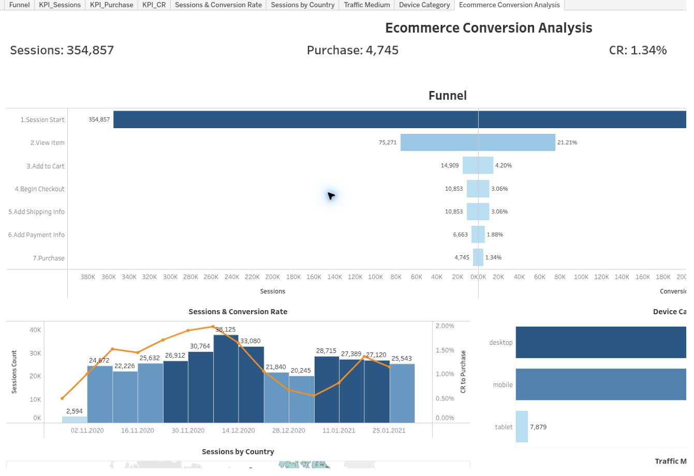
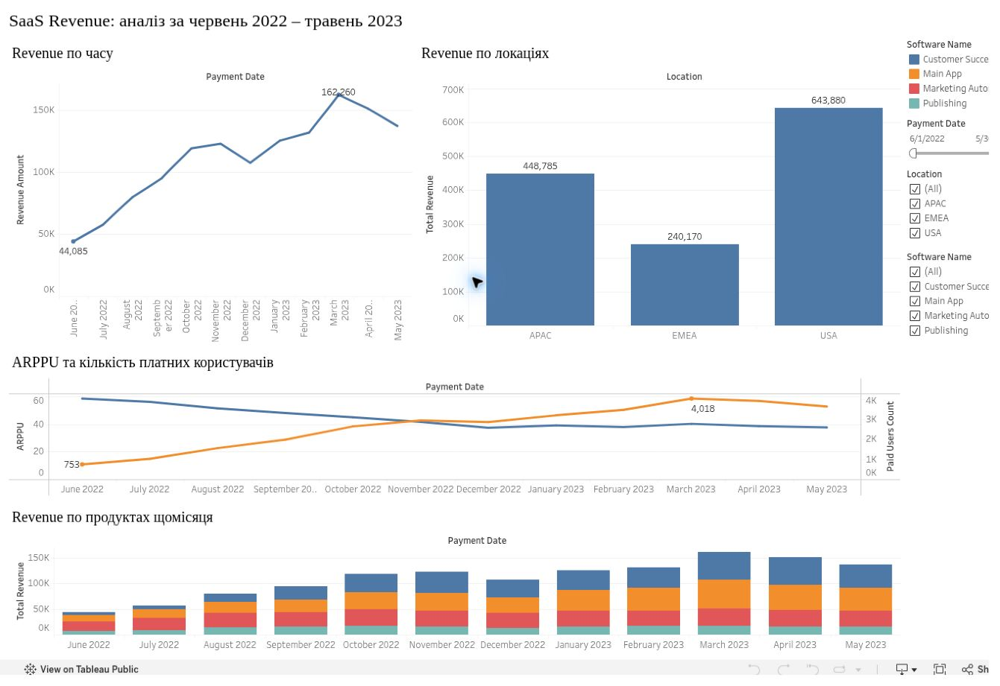
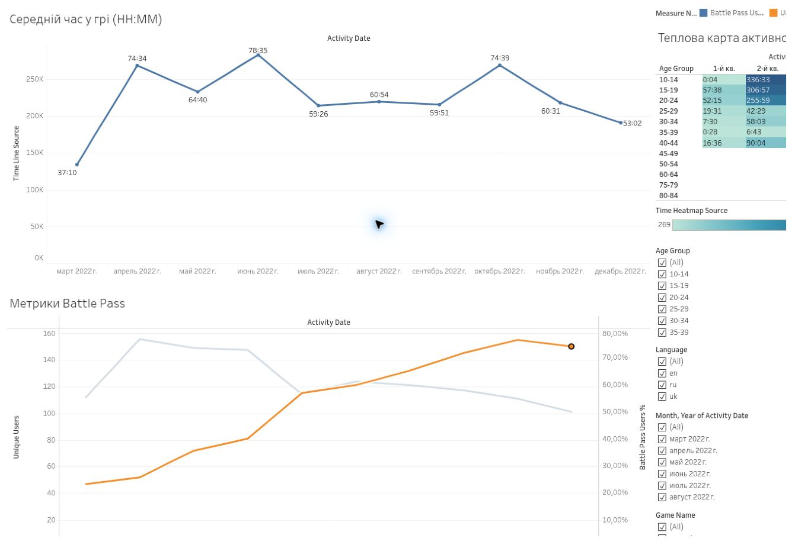
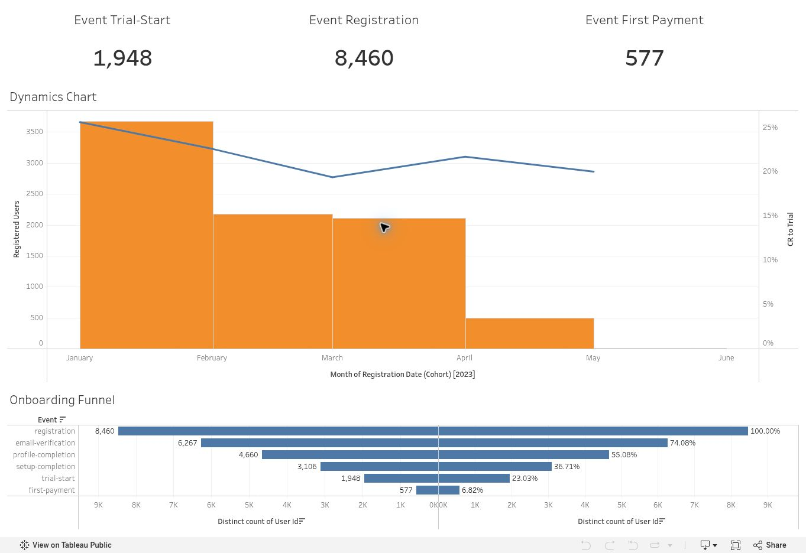

# Tableau Dashboards

Four projects I built during GoIT Data Analytics training. I used Tableau for the dashboards and SQL in BigQuery to prepare the ecommerce data.

## Ecommerce conversion

A seven-step funnel on GA4 sample data: **354,857 sessions, 4,745 purchases and 1.34% purchase conversion**.

[Project notes](projects/ecommerce-conversion.md) · [Live dashboard](https://public.tableau.com/app/profile/viacheslav.kozak/viz/EcommerceConversionAnalysis_17830668997120/EcommerceConversionAnalysis)

## Revenue and engagement

| SaaS revenue & cohorts | Gaming activity |
| --- | --- |
|  |  |
| Revenue, paying users, ARPPU and cohort comparisons. [Project notes](projects/saas-revenue-cohorts.md) | Time spent, Battle Pass activity and age groups. [Project notes](projects/gaming-engagement.md) |

## Product onboarding

Registration, trial and payment in one view, with monthly trends and conversion rates.

[Project notes](projects/product-onboarding.md) · [Live dashboard](https://public.tableau.com/app/profile/viacheslav.kozak/viz/hw_36_kozak/ProductOnboardingFunnel?publish=yes)

## Files

The `projects` folder contains the analysis notes and dashboard links; `assets` contains screenshots. The ecommerce notes also link to my submitted BigQuery query. Raw datasets and local Tableau workbook files are not stored here.

These projects explore educational datasets. The results describe the data, rather than changes measured after a business rollout.

[Full portfolio](https://tested-rain-de9.notion.site/Viacheslav-Kozak-Junior-Data-Analyst-Portfolio-40c9a2006fe9818a9bf2f87c0e0d29c4) · [Tableau Public](https://public.tableau.com/app/profile/viacheslav.kozak) · [LinkedIn](https://www.linkedin.com/in/slavakozak/)
