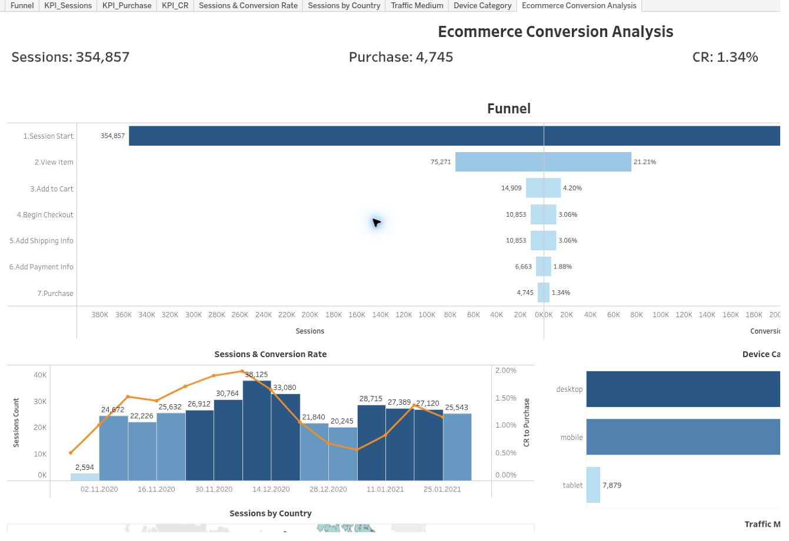

# Ecommerce Conversion Analysis

I used SQL in BigQuery to prepare GA4 event data, then built a Tableau dashboard to follow sessions from first visit to purchase.

**SQL · BigQuery · Tableau**

[Live dashboard](https://public.tableau.com/app/profile/viacheslav.kozak/viz/EcommerceConversionAnalysis_17830668997120/EcommerceConversionAnalysis) · [Submitted SQL query](https://console.cloud.google.com/bigquery?sq=578385795889:0e6e26b86c2542348ec8a620da0be80a)

## The analysis

The source is `bigquery-public-data.ga4_obfuscated_sample_ecommerce.events_*`, covering November 2020–January 2021.

The funnel follows seven steps: Session Start → View Item → Add to Cart → Begin Checkout → Add Shipping Info → Add Payment Info → Purchase.

I added session and conversion trends, a country map, traffic-medium and device comparisons, and filters for date, landing page, source, medium, campaign, device, language and OS.

## Results

| Measure | Value |
| --- | ---: |
| Sessions | 354,857 |
| Purchases | 4,745 |
| Purchase conversion | ≈1.34% |

The conversion shown is `4,745 / 354,857 × 100`. The submitted SQL produced 867,735 rows according to the project review; these are output rows, not unique sessions or users.

Use the live dashboard to compare segments with the same filters. Conversion from session start and conversion between consecutive stages answer different questions.

Final GoIT training project on public sample data. The analysis was not followed by a commercial rollout.

[All dashboards](../README.md)
