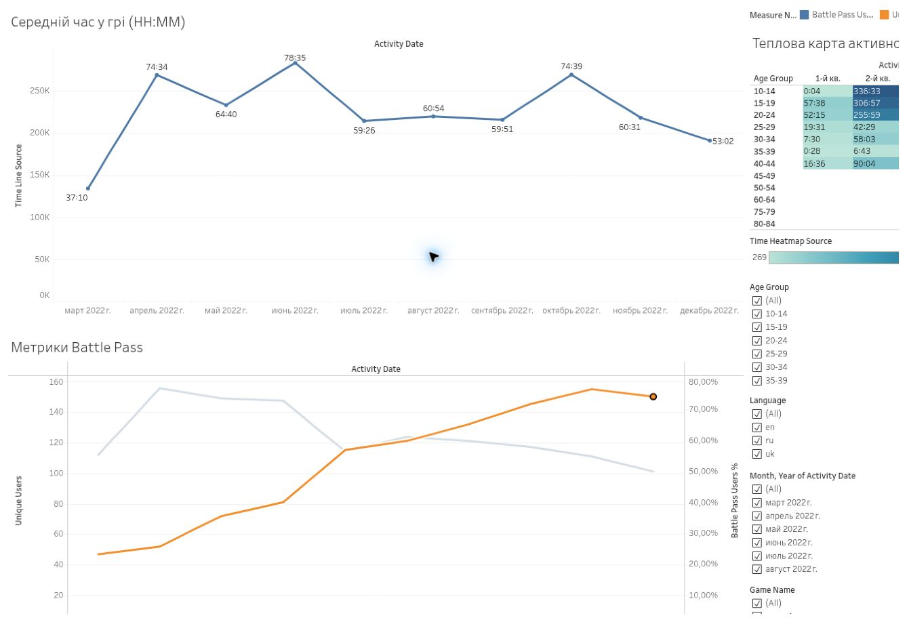

# Gaming Activity & Engagement
**Tableau Public · Gaming Analytics · Segmentation**

[Open live dashboard](https://public.tableau.com/app/profile/viacheslav.kozak/viz/HW_34_KOZAK_PART1/Dashboard1?publish=yes)

## Business question

How does player activity vary by game and age group, and how do users engage with Battle Pass activities?

## Data

Educational gaming activity data containing game and activity names, dates and user characteristics.

## My work

- Prepared calculated fields for activity and Battle Pass analysis.
- Built an activity heatmap and views comparing age groups.
- Worked with average time spent per player and HH:MM formatting.
- Separated game names from activity names to create a usable game filter.
- Added game and date filters and refined the dashboard layout.

## Result

An interactive dashboard for comparing player engagement, activity patterns and time spent across selected segments.

## Metric definition

**Average time per player = total time spent / number of players.**

This is different from average session duration. Use the selected date range and filters consistently when comparing groups.

## Skills demonstrated

Calculated fields, LOD expressions, table calculations, time metrics, segmentation, heatmaps and interactive filters.

## Scope

Educational project completed at GoIT. The dashboard describes activity in the supplied data; no increase in retention or gaming revenue is claimed. Live dashboard access is provided above; raw data and local workbook files are not included.

[Back to portfolio](../README.md)
