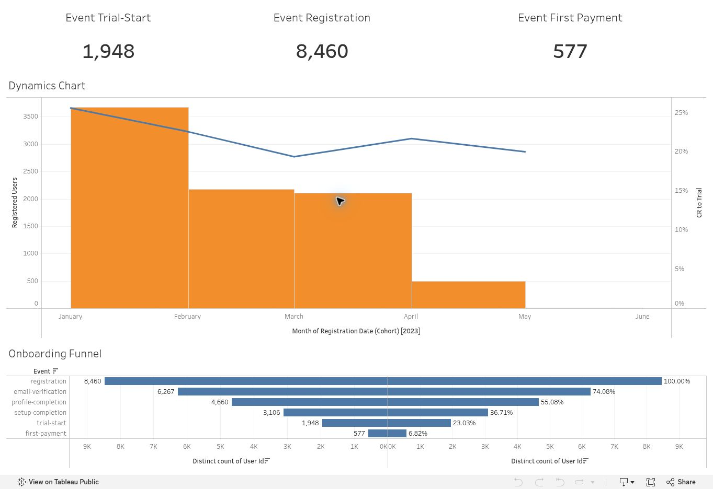

# Product Onboarding Funnel

A Tableau report following users from registration to trial and first payment.

[Live dashboard](https://public.tableau.com/app/profile/viacheslav.kozak/viz/hw_36_kozak/ProductOnboardingFunnel?publish=yes)

## What I built

Using educational user-event data, I created three KPI cards for registrations, trial users and paying users. The cards include registration-based conversion rates in their tooltips.

The report combines monthly registration and trial trends with a funnel showing user counts and conversion rates. I used dual-axis charts and adjusted the labels and layout to keep the stages readable.

## How conversion is grouped

Trial conversion is grouped by the user's registration month, even if the trial started later. Dividing trial events in one calendar month by registrations in that same month would measure something different.

GoIT training project. This is a descriptive analysis of the supplied funnel data; no product experiment or conversion uplift was measured.

[All dashboards](../README.md)
