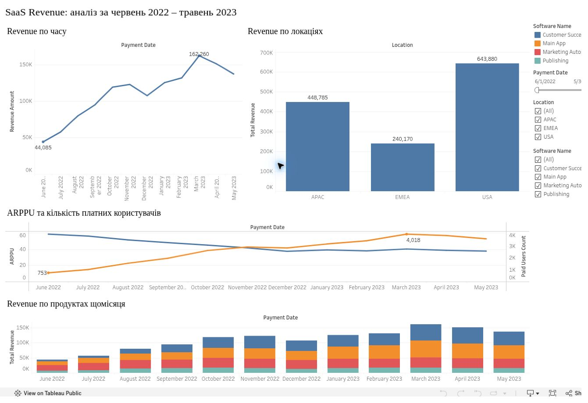
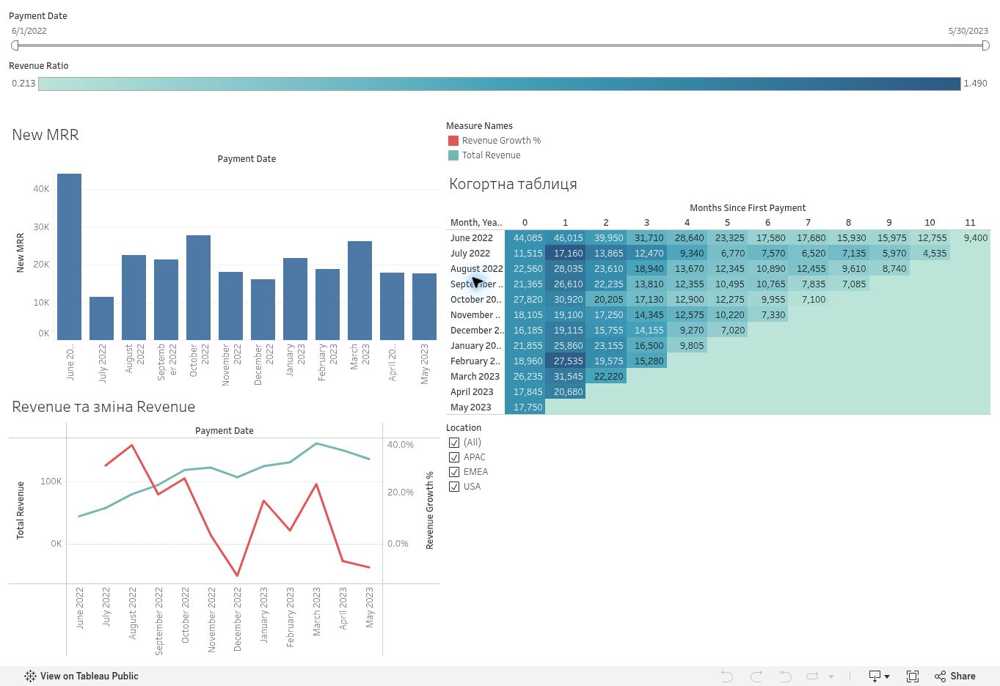

# SaaS Revenue & Cohorts

I built two Tableau dashboards to explore revenue, paying users and revenue by cohort.

**Tableau · Calculated fields · LOD · Table calculations**

[Revenue Overview](https://public.tableau.com/app/profile/viacheslav.kozak/viz/HW_32_KOZAK_SaaS_Revenue_Dashboard/Dashboard1?publish=yes)

## What I built

The first dashboard covers June 2022–May 2023 in educational transaction and user data. I calculated Total Revenue, Paid Users Count and ARPPU, then added trends, transaction distributions and segment filters.

The second dashboard adds a revenue cohort table and New MRR. I used LOD expressions and table calculations to build the cohort views.

[Revenue & Cohorts](https://public.tableau.com/app/profile/viacheslav.kozak/viz/HW_32_KOZAK_SaaS_Revenue_Dashboard/Dashboard2?publish=yes)

## Reading the dashboards

ARPPU measures revenue per paying user. When comparing cohorts, use the same cohort age and account for incomplete periods.

GoIT training project. The live views are available above; raw data and local workbook files are not included.

[All dashboards](../README.md)
